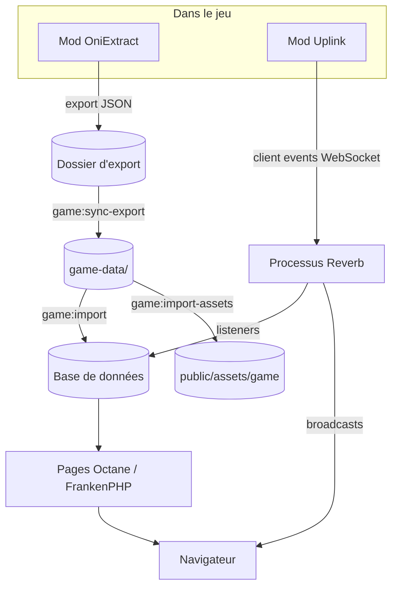

# Architecture

Le planner a deux chemins de données. **Les données de référence** (éléments, bâtiments, créatures, plantes…) sont importées depuis un export du jeu et changent rarement. **Les données de colonie** arrivent en direct pendant la partie, via le mod Uplink et Reverb.

## Processus

| Processus | Lancé par | Rôle |
| --- | --- | --- |
| Octane (FrankenPHP) | `composer devWithOctane` | Sert les pages Inertia. OPcache et le JIT tracing sont activés dans le `Caddyfile`. |
| Reverb | `php artisan reverb:start` | Serveur WebSocket. Le jeu s'y connecte ; ses listeners enregistrent ce que le jeu envoie. |
| Worker de queue | `php artisan queue:listen` | Exécute les broadcasts en file vers le navigateur. |
| Vite | `bun run dev` | Serveur de dev frontend avec HMR. |

## Carte du code

- `app/Services/GameImport/` : les readers transforment l'export OniExtract en enregistrements, les importers les persistent. Voir [Import des données du jeu](./game-data-import.md).
- `app/Services/Uplink/` et `app/Listeners/` : tout ce que le jeu envoie via Reverb. Voir [Uplink](./uplink.md).
- `app/Services/Viability/`, `app/Services/Critters/` : presenters et calculs derrière les pages colonie et créatures.
- `app/Data/` : objets spatie/laravel-data passés à Inertia ; leurs types TypeScript sont générés pour les pages Vue.
- `resources/js/pages/` : une page Vue par route ; les liens passent par Wayfinder, jamais par des URL écrites à la main.
