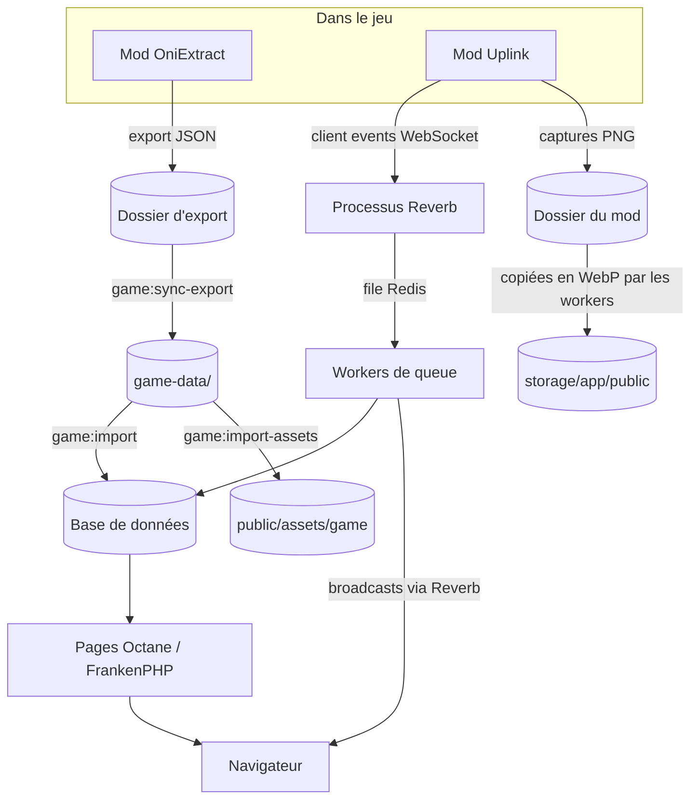

# Architecture

Le planner a deux chemins de données. **Les données de référence** (éléments, bâtiments, créatures, plantes…) sont importées depuis un export du jeu et changent rarement. **Les données de colonie** arrivent en direct pendant la partie, via le mod Uplink et Reverb.

## Processus

| Processus | Lancé par | Rôle |
| --- | --- | --- |
| Octane (FrankenPHP) | `composer devWithOctane` | Sert les pages Inertia. OPcache et le JIT tracing sont activés dans le `Caddyfile`. Les images du jeu (`/assets/game/`) y sont servies sans cache durable : le navigateur les revalide à chaque chargement, donc un nouvel import s'affiche tout de suite. |
| Reverb | `php artisan reverb:start` | Serveur WebSocket. Le jeu s'y connecte ; son listener met chaque message du jeu en file, sans le traiter. |
| Workers de queue | `composer run queue-workers` | Un worker pour `uplink-reliable` (messages fiables, dans l'ordre), quatre pour `uplink-state,default` (états, broadcasts vers le navigateur). |
| Vite | `bun run dev` | Serveur de dev frontend avec HMR. |
| Serveur MCP `oni` | Claude Code (`.mcp.json`) | Laisse l'assistant IA lire la colonie et les données du jeu. Voir [Serveur MCP](./mcp.md). |

## Carte du code

- `app/Services/GameImport/` : les readers transforment l'export OniExtract en enregistrements, les importers les persistent. Voir [Import des données du jeu](./game-data-import.md).
- `app/Listeners/`, `app/Jobs/Uplink/` et `app/Services/Uplink/` : tout ce que le jeu envoie via Reverb, et les commandes que le site lui renvoie. Les listeners comprennent aussi le contrôle de cohérence du surpeuplement, qui compare la règle du planner à celle du jeu à chaque état rapide. Voir [Uplink](./uplink.md).
- `app/Services/Viability/`, `app/Services/Critters/` : presenters et calculs derrière les pages colonie et créatures, et derrière les critters des zones (surpeuplement, alimentation).
- `app/Mcp/` et `app/Services/Mcp/` : le serveur MCP local et ses outils. Voir [Serveur MCP](./mcp.md).
- `app/Data/` : objets spatie/laravel-data passés à Inertia ; leurs types TypeScript sont générés pour les pages Vue.
- `resources/js/pages/` : une page Vue par route ; les liens passent par Wayfinder, jamais par des URL écrites à la main.
